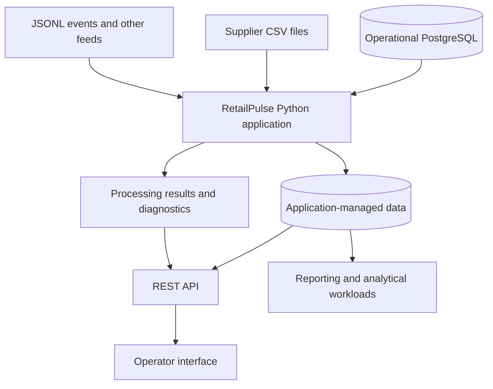

# RetailPulse

**A retail operations and data platform, built with Python.**

RetailPulse is an engineering project centered on the internal operations of a fictional omnichannel electronics retailer. It connects operational and external data sources, processes incoming information reliably, and makes consistent data available to people and applications.

The project is designed as a **real software product** rather than a collection of isolated exercises or dashboards. It covers backend development, data engineering, system design, operational reliability, and, eventually, a user-facing interface.

> **Project data is synthetic.** RetailPulse does not operate a real store or process real customer payments. The product capabilities below define its purpose; see the [feature roadmap](docs/01_roadmap.md) for delivery status.

## The problem

A retailer selling through physical stores, a website, and a mobile channel relies on several systems: orders and inventory in a database, supplier updates in files, and activity events in semi-structured feeds. Without a shared integration layer, keeping data consistent and diagnosing failed processes requires manual work.

**RetailPulse provides a single, maintainable technical foundation for integrating and using these sources.**

## Who it serves

| User | Problem RetailPulse addresses |
|---|---|
| **Catalog operator** | Import supplier prices and identify records that could not be processed. |
| **Logistics operator** | Retrieve consistent product, stock, order, and fulfillment information. |
| **Platform operator** | Track processing runs, investigate errors, and safely retry failed operations. |
| **Internal application** | Consume supported data through documented interfaces rather than reading source tables directly. |
| **Business analyst** | Work with reliable, consistently defined datasets for operational reporting. |

## Core workflows

RetailPulse is designed around five connected workflows:

1. **Ingest** — accept data from PostgreSQL, supplier files, and other supported sources.
2. **Validate and process** — enforce agreed data contracts, report invalid records, and apply business rules.
3. **Store reliably** — preserve traceability and support safe retries without unintended duplicates or partial updates.
4. **Expose information** — make operational data and processing results accessible through service interfaces and an operator UI.
5. **Operate and improve** — observe failures, automate recurring work, and use trustworthy data for reporting or targeted optimization.

These are **product responsibilities, not a claim that every workflow has already been implemented**.

## How the system fits together

This is a **logical product architecture**: it describes responsibilities and data flows, not a commitment to separate services or to a particular implementation of every component. Components are introduced only when a product requirement justifies them. The intended starting point is a **modular Python backend**, not a microservices architecture.

For implementation boundaries, trade-offs, and diagrams, see [Architecture](docs/architecture.md).

## Development environment and sample data

RetailPulse includes a reproducible simulation of its upstream business systems:

- **PostgreSQL (`source` schema):** customers, products, orders, payments, stores, warehouses, shipments, returns, inventory movements, and support cases.
- **Supplier data (CSV):** pricing updates with realistic edge cases.
- **Web events (JSON Lines):** browsing and checkout-related activity, including delayed or duplicated events.

The default dataset contains approximately **12,500 customers, 200,000 orders, 2,500 products, 52 stores, and 6 warehouses**. It deliberately includes imperfect data so the software can be tested against realistic failure scenarios.

The dataset is reproducible using a deterministic generator. Precise counts and sample-data characteristics are in [`data/manifest.json`](data/manifest.json), and source tables are documented in the [data dictionary](docs/02_data_dictionary.md).

**Important distinction:** the simulator and seed-data loader provide *test inputs*. They are not the RetailPulse ingestion application itself.

## Run locally

The development baseline uses **Python 3.12+, Docker Compose, PostgreSQL, and Git**. You can develop on Windows, Linux, or macOS with the appropriate shell commands.

Follow the [local setup guide](docs/getting_started.md) to create the environment, generate the fixtures, start PostgreSQL, and verify the source data. This guide also documents how to safely reset local fixtures.

## Project documentation

| Resource | Contents |
|---|---|
| [Getting started](docs/getting_started.md) | Development prerequisites and local bootstrap instructions |
| [Product scope](docs/00_cadrage.md) | Users, requirements, constraints, and non-goals |
| [Feature roadmap](docs/01_roadmap.md) | Delivery milestones, ticket progress, and next work |
| [Architecture](docs/architecture.md) | Components, technical boundaries, and design decisions |
| [Data dictionary](docs/02_data_dictionary.md) | Upstream data schemas and fields |
| [Engineering workflow](docs/engineering_workflow.md) | Tickets, review expectations, commits, and GitHub practices |
| [Tickets](tickets/) | User-facing requirements and acceptance criteria |

## Engineering principles

- **Start from a user need.** Tickets define observable behavior and acceptance criteria, not step-by-step lessons.
- **Design for maintainability.** Prefer clear Python modules, explicit interfaces, and simple, justified architecture.
- **Build for correctness.** Validate inputs, write meaningful tests, and make failures understandable.
- **Make processing repeatable.** Preserve traceability and handle retries, partial failures, and duplicate inputs intentionally.
- **Separate sources from managed data.** Treat simulated upstream records as inputs, not application-owned state.
- **Keep delivery reproducible.** Use documented configuration, version control, reviews, and automated checks as the product develops.
- **Choose tools for a reason.** APIs, cloud services, orchestrators, distributed processing, and frontend technologies must solve real requirements.

## Scope boundaries

RetailPulse is **not** a consumer storefront, a payment processor, or a complete ERP. It is an internal platform for integrating, operating, and exposing retail data. The project favors a coherent, verifiable software product over a long list of disconnected technologies.

**Implementation status and priorities live in the [roadmap](docs/01_roadmap.md), so this README can remain focused on the product itself.**
