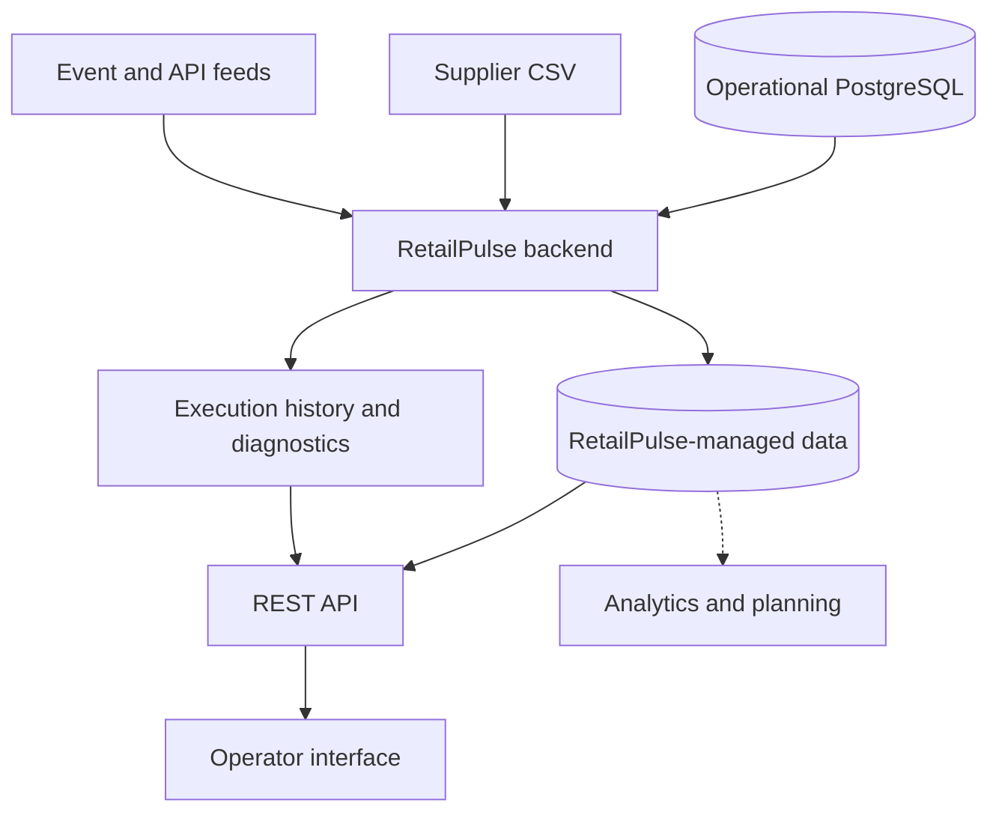

# RetailPulse

**An internal retail operations and data platform built around Python.**

RetailPulse helps a fictional omnichannel retailer connect disconnected operational systems, process incoming data reliably, and make trusted information available to internal teams and applications. It combines software engineering, data integration, and operational tooling in **one coherent product**.

RetailPulse is not a consumer storefront, payment processor, or complete ERP. Its role is to make retail data **usable, traceable, and accessible** without requiring every team to manipulate source databases or supplier files directly.

> The company and its data are synthetic. The workflows below describe the product's intended capabilities, not a claim that every feature is already deployed.

## The people it serves

| User | What they need |
|---|---|
| Catalog team | Import supplier cost updates and investigate rejected records. |
| Operations team | Review imports, understand failures, and safely retry work. |
| Logistics team | Find reliable product, stock, order, and fulfillment information. |
| Internal developers | Consume documented interfaces instead of coupling directly to source tables. |
| Decision makers | Access dependable operational indicators and, where useful, planning suggestions. |

## Core capabilities

**Data intake.** Read supported inputs such as supplier CSV files, operational PostgreSQL records, and event feeds. Verify their structure and record where they came from.

**Reliable processing.** Apply business rules, report rejected inputs, avoid accidental duplicate writes, preserve execution history, and support controlled retries.

**Operational access.** Expose relevant product, stock, order, and processing information through an API and an operator-facing application.

**Automation and insight.** Run repeatable processes, monitor results, and develop useful analyses or optimization features when there is a concrete operational need.

## How RetailPulse fits together

The system is designed as a **modular Python application** with explicit responsibilities for input, validation, business behavior, and persistence. An API and browser interface provide convenient ways to operate it; cloud infrastructure and analytics extend it when justified by the workload. The diagram describes the logical product, not a prescribed number of services.

## Development environment and sample data

A deterministic simulator produces representative source data for a retailer with approximately **12,500 customers, 200,000 orders, 2,500 products, 52 stores, and 6 warehouses**. Sources include PostgreSQL tables, supplier CSV updates, and JSON Lines web events. The data deliberately include edge cases so correctness and recovery can be tested.

The simulator and seed-data loader are **development fixtures**, not the RetailPulse application itself. See the [data manifest](data/manifest.json) and [data dictionary](docs/02_data_dictionary.md) for details.

## Documentation

- [Product specification](docs/product_spec.md) — actors, expected workflows, scope, and functional requirements.
- [Architecture](docs/architecture.md) — responsibilities, boundaries, intended stack, and technical decisions.
- [Getting started](docs/getting_started.md) — local installation and source-data bootstrap.
- [Roadmap](docs/01_roadmap.md) — milestones, current implementation boundary, and next steps.
- [Engineering workflow](docs/engineering_workflow.md) — development, reviews, and Git/GitHub practices.
- [Data dictionary](docs/02_data_dictionary.md) — structure of the simulated upstream sources.

## Engineering principles

- **Start with a real operator or application need**, not a framework or an exercise.
- **Prefer straightforward, maintainable software** to artificial distributed complexity.
- **Treat inputs as untrusted** and make failures understandable and repeatable.
- **Keep upstream sources separate** from data managed by RetailPulse.
- **Test meaningful behavior**, document architectural trade-offs, and review changes before merging.
- **Introduce technologies when they solve an actual problem** and keep the project reproducible.

RetailPulse is intended to grow as a single maintainable engineering product. Implementation status, changing priorities, and short-term decisions live in the [roadmap](docs/01_roadmap.md), not in this README.
