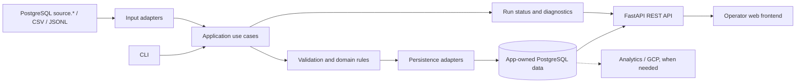

# RetailPulse — Architecture and technical direction

## 1. Implemented foundation

```text
src/simulator/generate.py
  ├── data/seed/*.csv ──> scripts/load_source.py ──> PostgreSQL 17 (source.*)
  ├── data/external/supplier_prices.csv
  └── data/external/web_events.jsonl
```

The simulator and loader are local fixture tooling; they do not implement any user-facing RetailPulse ingestion workflow. `docker-compose.yml` starts PostgreSQL and runs `sql/source_schema.sql` when initializing a **new** database volume.

## 2. Intended logical architecture (not yet implemented)



This is a **modular monolith**, not a commitment to microservices or to these exact module names. Input adapters, business operations, and persistence should have clear responsibilities. Simplicity takes priority over unnecessary abstractions.

## 3. Technology responsibilities

| Technology | Responsibility | Decision |
|---|---|---|
| Python 3.12+ | Core business processing and application logic | Existing baseline |
| PostgreSQL 17 | `source` simulation and future application-owned persistence | Existing baseline |
| Docker Compose | Local infrastructure reproducibility | Existing baseline |
| Git / GitHub | Code history, branches, code review | Existing baseline |
| `pytest` and Ruff | Behavior tests and consistent code quality | Introduce with first application code |
| Pydantic | Input validation and typed data contracts | Candidate for first import |
| SQLAlchemy + psycopg | Structured database access | Candidate when application persistence is introduced |
| Alembic | Controlled migrations for new application-owned schema | Candidate once that schema starts evolving |
| FastAPI | Versioned HTTP API to expose operations | Add when a consumer needs HTTP access |
| React + TypeScript | Browser UI consuming the API | Preferred direction; confirm when UI work starts |
| GitHub Actions | Automated code checks | Add when useful checks can run in CI |
| GCP (Cloud Run, Cloud Storage, BigQuery, Scheduler) | Deployment, file storage, analytical workloads and scheduling as needed | Defer until workload and cost model justify services |

Dependencies must be added to `requirements.txt` (or replaced with a coherent packaging approach) **only when used**. The current bootstrap needs no external Python packages.

## 4. Data ownership

- `source.*` contains **upstream synthetic operational data**; do not overwrite it to make imports appear to work.
- Application-managed entities (e.g., supplier events, imported cost history, processing runs) need **separate ownership**, likely a new PostgreSQL schema such as `app`.
- Source data may contain duplicates, missing values, or invalid supplier rows by design. Validation rules must define what is acceptable and what is rejected.
- Supplier `new_cost_eur` represents acquisition **cost**, not customer-facing `list_price_eur`.
- The stock source consists of inventory movements; a derived current balance requires documented assumptions and validation.

## 5. Reliability and interfaces

For an import use case, first define what an execution changes, which records it accepts/rejects, and what happens on retry or failure. Prefer bounded transactions and stable identifiers to implicit exactly-once claims. Tests should exercise edge cases using disposable fixtures; avoid depending on a developer's populated source database.

CLI and HTTP endpoints should invoke shared application behavior rather than duplicating business rules. The frontend should consume versioned API contracts and should never connect to PostgreSQL directly.

## 6. Design decisions to make when relevant

- Identity of a supplier update (event ID, supplier, SKU, effective date) and conflict policy.
- Schema design for import records, history, and execution metadata.
- All-or-nothing imports versus accepted/rejected row handling.
- Source fixture regeneration and local test database isolation.
- Authorization, deployment, scheduling, and cloud services when the product needs them.

For important decisions, record the chosen approach, alternatives, and consequences in an ADR or a short dated section of the architecture documentation. Avoid speculative infrastructure work.
